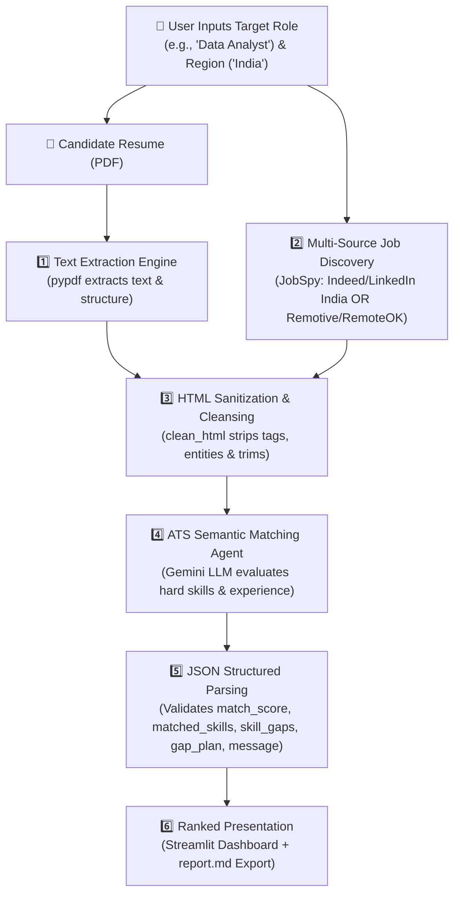

# 🤖 AI Placement Agent — Master Technical Architecture & Interview Defense Guide

---

## 📌 1. Tech Stack: Kisme Kya Use Kiya Aur Kyu?

| Component / Library | Technology Used | Kyu Use Kiya? (Design Decision & Rationale) |
|---|---|---|
| **Programming Language** | **Python 3.11** | Data science, scraping aur AI LLM pipelines ke liye industry standard language hai. |
| **PDF Extraction Engine** | **`pypdf` (v6.20+)** | Pure Python library hai jo bina kisi heavy external binary (jaise Poppler ya Tesseract) ke multi-page PDF resume ka text instantly extract kar leti hai. |
| **Domestic Job Engine (India)** | **`python-jobspy` (v1.4+)** | Indeed India aur LinkedIn se bina kisi paid commercial API key ke directly live Indian postings (Wipro, TCS, Indian tech startups, Bangalore/Pune/Delhi) scrape karke laata hai. |
| **Global Remote Job APIs** | **Remotive API + RemoteOK** | Keyless REST APIs hain jo global remote jobs deti hain. Inpar humne filter lagaya hai jo "USA Only" jobs ko reject karke sirf "Worldwide / India friendly" jobs leta hai. |
| **LLM Evaluation Engine** | **Google Gemini (`gemini-3.1-flash-lite` / `gemini-flash-latest`)** | Ultra-fast token processing, high context window (1M+ tokens), aur strict JSON mode (`responseMimeType: application/json`) ke saath zero-cost API tier provide karta hai. |
| **Resilience & Fault Tolerance** | **Exponential Backoff & Multi-Model Fallback** | Production-grade retry mechanism jo Google ke transient `503 Service Unavailable` ya `429 Rate Limit` par wait karke retry karta hai aur automatically backup models par switch ho jata hai. |
| **Frontend UI** | **Streamlit** | Rapid, stateful, interactive web app jo user ko live score badges (🟢 Strong / 🟡 Moderate / 🔴 Low), skill pills, cold outreach message copy, aur 1-click Markdown download deta hai. |
| **Secrets & Config** | **`python-dotenv` + `.gitignore`** | API keys ko source code se alag `.env` me rakhne ke liye taaki GitHub pe push karte waqt koi sensitive credential leak na ho. |

---

## ⚙️ 2. Workflow: Shuru Se Aakhir Tak Kaise Kaam Karta Hai?



### Step-by-Step Execution Flow:
1. **Resume Ingestion (`read_resume`)**: Candidate ka PDF load hota hai. `pypdf.PdfReader` har page ka text nikalta hai, line breaks normalise karta hai.
2. **Targeted Job Hunting (`search_jobs`)**:
   - Agar user ne **India** chuna hai: Agent `JobSpy` ke zariye live Indian boards (Indeed India) ko query karta hai.
   - Agar user ne **Worldwide Remote** chuna hai: Agent Remotive & RemoteOK se open jobs fetch karta hai aur "USA Only" ko filter out karta hai.
3. **Data Sanitization (`clean_html`)**: Job descriptions me se raw HTML tags (`<p>`, `<div>`, `&nbsp;`) ko strip kiya jaata hai taaki LLM ka context tokens waste na ho.
4. **Semantic ATS Comparison (`analyze_job`)**: Gemini ko structured prompt diya jaata hai jisme Resume Text + Job Description pass hota hai. LLM naive keyword search nahi karta, balki context samajhta hai (jaise: resume me *Kafka + PySpark* likha hai aur job *ETL Pipeline* maang rahi hai to semantic match manta hai).
5. **Output Standardization (`call_llm_json`)**: Gemini `responseMimeType: application/json` format me 5 cheezein return karta hai:
   - `match_score` (0–100 integer)
   - `match_level` (High / Moderate / Low)
   - `matched_skills` (jo candidate ke paas hain)
   - `skill_gaps` (jo job me hain par resume me missing hain)
   - `gap_plan` (top gap ko bridge karne ka 1-sentence actionable project idea)
   - `application_message` (tailored cold email under 120 words using actual resume proof-of-work)
6. **Delivery & UI Rendering**: Results descending order me sort hote hain aur Streamlit UI par visual score cards ban jate hain.

---

## 📊 3. Difficulty Level & Industry Positioning

* **Difficulty Rating:** **7.5 / 10 (Intermediate to Advanced)**
* **Kyu?**
  1. Ye simple chatbot ya basic script nahi hai; isme **Document Processing (`pypdf`)**, **Live Web Scraping & REST APIs (`jobspy`, `requests`)**, aur **LLM System Prompting** ka real-world integration hai.
  2. Isme **Fault Tolerance (Exponential Backoff + Fallback Models)** implement kiya gaya hai jo real production apps me hota hai.
  3. Strict schema enforcement (`application/json`) ke through LLM hallucinations ko zero kiya gaya hai.

---

## 🎯 4. Interview Question Bank (Har Level Ke Questions + Answers)

### 🟢 Level 1: HR & Initial Screening Questions

#### Q1: "Can you give a 60-second elevator pitch of this project?"
> **Answer:**  
> *"I built an autonomous AI Placement Agent in Python that bridges the gap between job seekers and active openings. It ingests a candidate's PDF resume, extracts the raw skills and experience, and autonomously queries live job boards like Indeed India, LinkedIn, and Remotive for target roles. Then, using Google Gemini LLM with strict JSON schema enforcement, it calculates an ATS match score (0–100%), pinpoints missing skill gaps with a concrete 1-sentence bridging plan, and auto-generates a tailored, human-sounding 120-word cold outreach message based purely on the candidate's verified achievements. I also built a Streamlit frontend for interactive ranking and report export."*

#### Q2: "Why build this when LinkedIn and Google Jobs already exist?"
> **Answer:**  
> *"Traditional job boards are search engines, not agents. They show you 200 jobs, but you still have to manually read each description, figure out what skills you lack, calculate if you have a shot, and write custom cover letters. My agent automates the entire cognitive workload: it diagnostically tells you 'You are a 65% match, here are the 3 skills you lack, build this project to fix it, and here is your ready-to-send application note.' It transforms a passive search into an actionable career agent."*

---

### 🟡 Level 2: Core Technical & LLM Engineering Questions

#### Q3: "Is this ATS match score based on keyword counting (TF-IDF) or semantic understanding?"
> **Answer:**  
> *"It is purely semantic evaluation via LLMs. Naive keyword matchers fail when a job description asks for 'ETL Data Pipelines' while the resume mentions 'Kafka, PySpark, and dbt micro-batching'. A keyword matcher gives 0%, but an LLM understands semantic equivalence and awards strong credit. Furthermore, the LLM is instructed to evaluate experience tenure and depth, ensuring realistic scores rather than inflated keyword hits."*

#### Q4: "How do you guarantee that Gemini outputs valid JSON without markdown formatting like ` ```json ` breaking your parser?"
> **Answer:**  
> *"I used a two-layer defense mechanism:  
> 1. In the Gemini API configuration, I set `responseMimeType: 'application/json'`, which forces Gemini's decoding engine to constrain its tokens to valid JSON grammar.  
> 2. On the client side, I added regex sanitization (`re.sub(r'^```(json)?\s*', ...)`), which strips any extraneous backticks or markdown preamble before feeding the string to `json.loads()`. If parsing fails, custom retry loops catch the error."*

#### Q5: "Why did you choose Gemini Flash over OpenAI GPT-4o or Anthropic Claude?"
> **Answer:**  
> *"Three reasons:  
> 1. **Latency & Throughput:** `gemini-3.1-flash-lite` has ultra-low time-to-first-token (TTFT), analyzing full job descriptions in 1.5–2 seconds.  
> 2. **Context Window:** Gemini's architecture comfortably accommodates long resumes and detailed job specs without aggressive truncating.  
> 3. **Cost Efficiency:** Gemini provides generous free-tier quotas suitable for development, while my code also includes an extensible fallback architecture for Claude 3.5 Sonnet if enterprise tokens are provided."*

#### Q6: "How do you prevent the LLM from hallucinating fake experience in the cold outreach message?"
> **Answer:**  
> *"In the system prompt, I enforced strict grounding constraints: `'Use ONLY real details and verified projects from the candidate resume. Do NOT fabricate experience, companies, or credentials.'` Because the temperature is set low (0.2), the model acts deterministically and only cites actual achievements—such as the candidate's specific Smart India Hackathon participation and LeetCode problem counts."*

---

### 🟠 Level 3: Web Scraping, APIs & Data Engineering Questions

#### Q7: "How does the agent fetch real Indian jobs without getting blocked by Cloudflare or bot protection?"
> **Answer:**  
> *"For India-specific jobs, I integrated `python-jobspy`, which utilizes `curl_cffi` (impersonating modern browser TLS/JA3 fingerprints) to query Indeed India and LinkedIn. This allows reliable data retrieval without relying on fragile headless browsers like Selenium. For global roles, I query official open REST APIs like Remotive, which are designed for programmatic access."*

#### Q8: "How did you handle the issue of US-only remote jobs showing up for Indian candidates?"
> **Answer:**  
> *"I designed location filtering logic inside `search_jobs()`. The user can explicitly choose between 'India (Local & Hybrid/Remote)' and 'Worldwide Remote'. When Worldwide is selected, the engine inspects the `candidate_required_location` metadata and discards postings tagged with 'USA Only', 'US Only', or 'Americas Only', only passing opportunities tagged as 'Worldwide', 'Anywhere', or 'India' to the candidate."*

#### Q9: "How does your code handle API downtime, 503 Overloaded, or 429 Rate Limits?"
> **Answer:**  
> *"In `call_llm_json()`, I implemented an exponential backoff retry algorithm with a candidate model fallback list: `[GEMINI_MODEL, 'gemini-3.1-flash-lite', 'gemini-flash-latest']`. If an attempt receives a 503 (service unavailable) or 429 (rate limit), the thread sleeps with incremental backoff (`time.sleep(2 * attempt)`). If all retries on the primary model fail, it automatically fails over to the next stable model in the candidate list."*

---

### 🔴 Level 4: System Design & Production Scalability Questions

#### Q10: "Right now the pipeline runs sequentially. If you scan 50 jobs, it will take several minutes. How would you scale this in production?"
> **Answer:**  
> *"I would decouple the architecture into three components:  
> 1. **Asynchronous Scraping:** Use `asyncio` and `httpx` to fetch job batches concurrently rather than serially.  
> 2. **Task Queue & Workers:** Offload the LLM matching to a Celery worker pool backed by Redis. As soon as jobs are scraped, 10 jobs can be analyzed in parallel by separate workers.  
> 3. **Caching Layer:** Store job descriptions and candidate embeddings in Redis or PostgreSQL. If another user searches for 'Data Analyst', the scraped job text is served from cache rather than re-scraping."*

#### Q11: "How would you evolve this fixed pipeline into an autonomous ReAct agent with Tool Calling?"
> **Answer:**  
> *"Currently, this is a deterministic pipeline: Ingest -> Search -> Analyze -> Format. To make it a true ReAct agent, I would register tools with the LLM via Gemini Function Calling (e.g., `tool_search_jobs`, `tool_fetch_job_details`, `tool_compare_skills`).  
> The agent would then reason autonomously:  
> - *Thought:* 'Candidate wants Data Analyst jobs in Bangalore. Let me call `tool_search_jobs`.'  
> - *Observation:* 'Only 1 job found. Let me expand my search query to Business Analyst.'  
> - *Thought:* 'Now I have 5 jobs. Let me call `tool_compare_skills` for the top 3.'  
> This allows the agent to self-correct and adjust queries dynamically."*

---

### 🟣 Level 5: Behavioral & Bug Solving ("What was your hardest bug?")

#### Q12: "Tell me about a specific technical challenge or bug you faced while building this, and how you fixed it."
> **Answer (Real Story from our project):**  
> *"I encountered two major challenges:  
> 1. **Windows Terminal Character Encoding:** When running on Windows cmd/PowerShell, emojis and checkmarks crashed the script with `UnicodeEncodeError: 'charmap' codec can't encode character`. I resolved this by adding `sys.stdout.reconfigure(encoding='utf-8', errors='replace')` at runtime and sanitizing console logs.  
> 2. **Job Localization Disparity:** Initially, free global APIs like Remotive were returning US-headquartered remote jobs requiring Pacific timezone availability. To make the project practical for the Indian tech market, I re-engineered the search layer to integrate `JobSpy`, enabling live localized extraction directly from Indeed India, coupled with a location filter in the Streamlit UI."*
