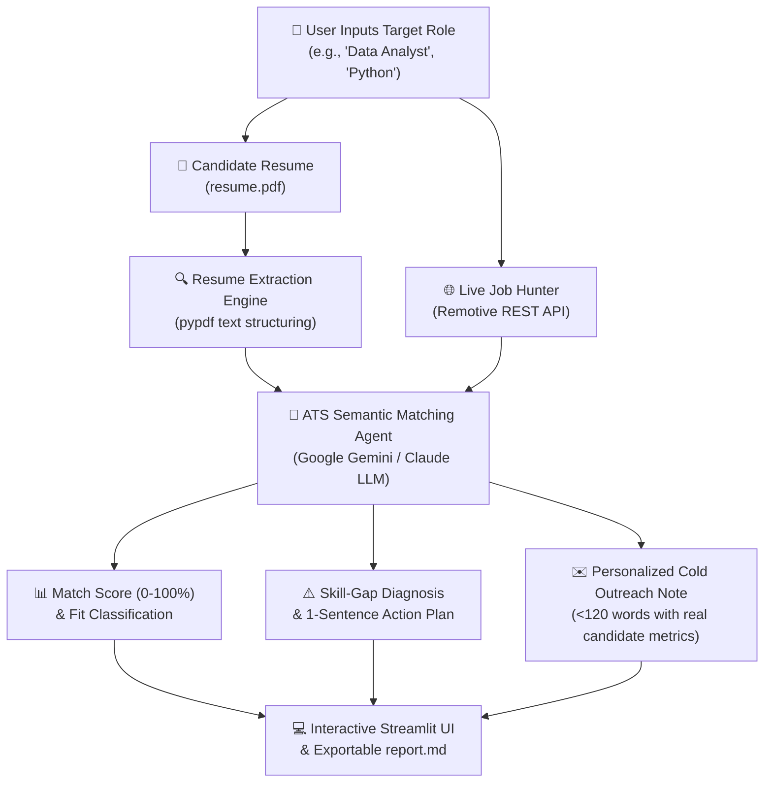

# 🤖 AI Placement Agent — Autonomous Job Matcher & ATS Optimizer

[](https://www.python.org/)
[](https://streamlit.io/)
[](https://ai.google.dev/)
[-D97706.svg)](https://anthropic.com/)
[](LICENSE)

An autonomous AI agent that ingests a candidate's resume, scours live tech job markets via external APIs, performs deep semantic ATS matching, pinpoints skill gaps with concrete bridging plans, and drafts personalized, human-sounding cold application messages.

---

## 📌 Architecture & Workflow



---

## ✨ Key Capabilities

1. **📄 Intelligent PDF Extraction**: Automatically extracts and sanitizes text from multi-page PDF resumes using `pypdf`.
2. **🌐 Real-Time Job Discovery**: Directly fetches live opportunities from the Remotive API with no brittle web scraping or headless browsers.
3. **🎯 Rigorous ATS Matching**: Analyzes hard tech stack compatibility and experience depth, generating a 0–100% match score rather than relying on naive keyword count.
4. **⚠️ Gap Analysis & Bridge Plan**: Distinguishes between what the candidate knows vs. what the role requires, providing a concrete action item (e.g., specific project or certification) to close the gap.
5. **✉️ Cold Application Message Generator**: Produces tailored, punchy, cold email pitches (<120 words) using real achievements from the candidate's resume without generic AI clichés.
6. **💻 Dual Execution Modes**:
   - **CLI Mode**: Fast batch execution saving a formatted `report.md`.
   - **Interactive UI**: Clean, responsive Streamlit dashboard with score badges, skill pills, and one-click application links.

---

## 🚀 Quickstart Guide

### 1. Clone & Navigate to Repository
```bash
git clone https://github.com/laxmi345/placement-agent.git
cd placement-agent
```

### 2. Install Dependencies
```bash
pip install -r requirements.txt
```

### 3. Configure API Key
Create a `.env` file in the root directory:
```env
# Google Gemini API (Free tier available at https://aistudio.google.com/)
GEMINI_API_KEY=your_gemini_api_key_here
GEMINI_MODEL=gemini-3.1-flash-lite

# Optional: Claude Key (if using Anthropic)
# ANTHROPIC_API_KEY=your_claude_key_here
```

### 4. Run CLI Pipeline
```bash
# Usage: python agent.py "<job_goal>" "<resume_path>" <job_limit>
python agent.py "data analyst" resume.pdf 5
```
Results will be output to console and saved as `report.md`.

### 5. Launch Streamlit Web App
```bash
streamlit run app.py
```
Open your browser at `http://localhost:8501`.

---

## 🛠️ Tech Stack & Tools

| Component | Technology | Rationale |
|---|---|---|
| **Language** | Python 3.11+ | Industry standard for AI agent workflows |
| **LLM Engine** | Google Gemini (`gemini-3.1-flash-lite`) / Claude 3.5 Sonnet | Ultra-fast JSON structuring and semantic evaluation |
| **PDF Extraction** | `pypdf` | Zero external binary dependency PDF parser |
| **Job Market API** | Remotive API | Reliable public REST API for live remote tech openings |
| **Frontend UI** | Streamlit | Rapid interactive prototyping with stateful sessions |
| **Environment** | `python-dotenv` | Secure credential management |

---

## 💼 How to Feature This Project on Your Resume

**AI Placement Agent | Autonomous Job Matching & ATS Diagnosis Pipeline**
- *Engineered an autonomous placement agent in Python leveraging Gemini LLMs and REST APIs to match resumes against live job openings.*
- *Implemented automated PDF resume extraction, semantic ATS scoring (0–100%), and skill-gap identification with actionable bridging roadmaps.*
- *Designed prompt architecture enforcing strict JSON schema for zero-shot cold application message generation (<120 words).*
- *Built an interactive Streamlit frontend with dynamic fit badges, skill tags, and exportable Markdown placement reports.*

---

## 📄 License
This project is open-source under the [MIT License](LICENSE).
